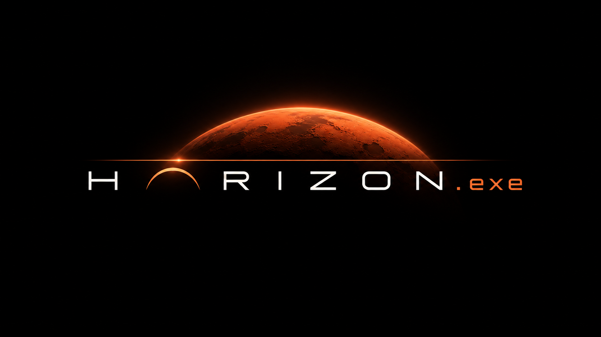

# ARES-PATH
### Mars Tactical Navigation & Astronaut Survival System
**NASA Space Apps Challenge — Team HORIZON.exe**

<!-- 🔴 PEGA AQUÍ EL LINK DE RENDER EN LUGAR DE "#" -->
[🚀 **LIVE DEMO ON RENDER (🔴 PEGA AQUÍ TU LINK DE RENDER)**](#) · [🎥 Pitch Video](#) · [📄 Space Apps Submission](#)

> *"On Mars, the fastest route is not always the safest one. ARES-PATH computes both."*

---

## 🌐 Live Cloud Deployment (Render)

> ### 🔴 ACCIÓN REQUERIDA ANTES DE ENTREGAR:
> **1. Ve a tu dashboard en Render y copia la URL pública de tu servicio (ejemplo: `https://ares-path.onrender.com`).**  
> **2. Reemplaza el texto `🔴 [PEGA AQUÍ TU LINK DE RENDER]` tanto en el enlace de abajo como en el botón superior `[🚀 LIVE DEMO ON RENDER]` y en el diagrama de arquitectura.**  
> **3. Borra este cuadro de instrucciones una vez que hayas pegado tu enlace.**

🔗 **Access the live application directly in your browser:**  
👉 **[🔴 PEGA AQUÍ TU LINK DE RENDER](https://tu-app.onrender.com)**

*(Note: Since the app is hosted on Render's cloud infrastructure, initial cold-start wake-up may take ~15–30 seconds on the first request).*

---

## 🚀 About the Project

**ARES-PATH** is an interactive Mars tactical navigation and survival system built by **HORIZON.exe** for the NASA Space Apps Challenge 2026. Deployed as a full-stack cloud web application on **Render**, it empowers astronauts and mission planners to:

- **Calculate the optimal EVA route** between mission-critical regions using a custom A\* pathfinding engine that accounts for topographic obstacles, slope gradients, atmospheric pressure, dust storms, and suit PLSS energy constraints.
- **Monitor real-time vital signs** (O₂ reserves, PLSS power, fatigue index) through a live HUD panel driven by the MEIS physiological model.
- **Simulate and respond to dust storm emergencies** with an automated escape-route algorithm that redirects the astronaut to the nearest safe refuge.
- **Visualize the Martian surface** in dual-mode: an interactive **3D orbital globe** (Three.js / Globe.gl) and a **2D tactical map** (Leaflet.js) with official IAU/NASA Mars Trek nomenclature, real tile imagery (Viking Realist, MOLA Relief), and animated astronaut tracking.

The backend runs on a lightweight Python HTTP server (`servidor_api.py`) backed by an embedded SQLite telemetry database (`marte_telemetria.db`) populated with NASA Space Apps datasets — delivering instant, zero-setup access from any browser via **Render**.

---

## ⚠️ The Challenge

Surviving on the surface of Mars presents an unprecedented set of compounding engineering and human-factors challenges:

| Challenge | Why It Matters |
| :--- | :--- |
| **Communication Latency** | Signal delay of 4–22 minutes (one-way) makes real-time Earth support impossible during emergencies. Crews must be **fully autonomous**. |
| **Hostile Atmosphere** | ~95% CO₂, surface pressure of 600–900 Pa (0.6–0.9% of Earth), and temperatures ranging from 150 K to 215 K demand continuous suit pressurization. |
| **Topographic Hazards** | Slopes exceeding 20° (Olympus Mons, Erebus Montes), graben fracture zones (Acheron Fossae), and slope-streak landslide fields (Lycus Sulci) are lethal without proper routing. |
| **Dust Storms** | Seasonal regional storms and global events block up to 99% of solar irradiance, critically reducing power generation and visibility. Hellas Planitia is classified as the primary global dust source. |
| **Physiological Fatigue** | O₂ consumption, thermal management, and locomotion biomechanics of the spacesuit PLSS create strict time and resource limits on every EVA. |

ARES-PATH addresses all five dimensions simultaneously in a single, cloud-accessible mission tool.

---

## ✨ Core Features

### 🌐 Dual-View Mars Visualization
- **3D Orbital Globe** — Interactive, rotatable Mars globe (Three.js + Globe.gl) with atmospheric glow, real Martian texture, and clickable region markers.
- **2D Tactical Map** — Full-planet Leaflet map using **NASA Mars Trek tile services** (Viking Realist + MOLA Topographic Relief) in EPSG:4326 projection.
- Seamless animated transition between both views.

### 🗺️ A\* Tactical Route Planning
- Selectable origin and destination from **6 major Martian regions** backed by NASA telemetry data.
- Real-time polyline rendering of the computed optimal path with **arc-bypass nodes** around blocked zones.
- Route automatically **avoids** ("Esquivar") Olympus Mons, Erebus Montes, Valles Marineris, Noctis Labyrinthus, and Hellas Planitia.
- Route emits **caution warnings** ("Precaucion") when passing near Lycus Sulci (landslide zone) or Acheron Fossae (fracture zone).
- Animated astronaut SVG marker walks the computed route in real time.

### 🧬 MEIS Physiological HUD (Live Suit Telemetry)
- **O₂ bar** — Tracks oxygen consumption using the **Weir calorimetric equation** + PLSS structural leak rate (8.0 g/h). Tank capacity: 950 g / 665.5 L.
- **Energy bar** — Tracks PLSS electrical power draw (base 95 W_e + pump + heating + dust penalty). Battery capacity: 1,100 Wh_e.
- **Emergency reserve alert** — Flashing visual alarm when O₂ or power enters critical reserve.
- **Fatigue index** — Composite metric from locomotion effort factor, travel time, and slope grade.

### 🌪️ Dust Storm Emergency System
- One-click storm simulation with **4 regional storm buttons** (each pre-sets atmospheric parameters and dust opacity overlay).
- **Emergency evacuation** endpoint (`/api/emergencia-tormenta`) instantly re-routes from the current node to the nearest safe refuge using A\* with storm-penalty parameters.
- Full-screen red storm overlay animation.

### 🏷️ IAU/NASA Mars Trek Nomenclature
- **250+ official IAU geographic names** (Terrae, Planitiae, Montes, Valles, Fossae, Chasmata, etc.) rendered as zoom-sensitive labels on the 2D map.
- Three label tiers: *Macro* (global structures, > 1,500 km), *Medio* (regional, 500–1,500 km), *Detalle* (local, < 500 km).

### 📱 Fully Responsive Design
- Adaptive layout for phone (≤ 680 px), tablet/laptop (≤ 1,024 px), desktop, and 4K displays (≥ 2,400 px).
- Collapsible side panels to prevent overlap on small screens.
